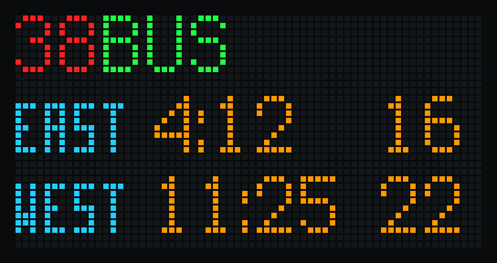

# Build a bus arrival board

A Wi-Fi connected 64×32 LED display for two Bay Area transit stops or routes,
powered by an Adafruit MatrixPortal M4 and the 511 SF Bay Stop Monitoring API.



Firmware layout rendered with sample arrivals. The first number in each row is
the next arrival in minutes and seconds. The second is the following arrival
in whole minutes. `DUE` means less than a minute.

## Before you buy

- **Confirm the data.** Pick two boarding platforms and a route for each.
  Find the agency’s 511 operator ID, each platform’s public stop code, and the
  exact route `LineRef` returned by the API. Check the direction and destination
  for each platform. Nearby platforms can have different codes.
  [511 transit data and operator information](https://511.org/open-data/transit)
- **Pick the hardware.** The Adafruit Matrix Portal Starter Kit (#4812) bundles
  the MatrixPortal **M4**, 64×32 RGB HUB75 panel, diffuser, and power supply.
  Bring a USB-C **data** cable and choose a stand or mount. A 4 mm-pitch panel
  has an active area of about 10×5 inches.
  [Shopping checklist](SHOPPING_CHECKLIST.md)
- **Check coverage.** For a city outside the 511 SF Bay service area, identify
  the agency’s live predictions API first. Using another provider requires a
  different data adapter in the laptop and firmware code.

## Set up your 511 API access

1. Submit your name and email on the request form after reviewing the terms.
   Use the token that 511 sends to that address. The same form retrieves an
   existing token for the same email. [Request or retrieve a 511 token](https://511.org/open-data/token)
2. Choose **Agency**, **Route**, **Direction**, then **Stop**. Record the
   displayed Stop ID for each boarding platform. Repeat for the second row,
   even when both platforms share a street name. [Find a Transit Stop ID](https://511.org/travel/transit/stop-id)
3. Find your agency's operator ID in the **GTFS Operators** feed. Muni's ID
   is `SF`. The operator list includes agencies with a static feed. Confirm
   live predictions for both rows in the next section. [511 Transit API reference](https://511.org/open-data/transit)

## Verify your stops on a computer

Clone this repository and open a terminal in its folder. Use Python 3.11 or newer.

```sh
git clone https://github.com/psatyajeet/bus-arrival-board.git
cd bus-arrival-board
cp .env.example .env
```

Open `.env` in a text editor. Enter your token, the two stop codes, and your
route for each row. A route's public number is a starting point. The live
response's `LineRef` gives you the exact value. Keep your token in your
local `.env` and later on the device.

| Setting | What to enter |
| --- | --- |
| `TRANSIT_511_TOKEN` | Your 511 key. Keep it on your computer and device. |
| `BOARD_ROW1_AGENCY`, `BOARD_ROW2_AGENCY` | 511 operator ID for each row, such as `SF` for Muni. |
| `BOARD_ROW1_STOP`, `BOARD_ROW2_STOP` | The 511 public stop code for each boarding platform. |
| `BOARD_ROW1_ROUTE`, `BOARD_ROW2_ROUTE` | Exact case-sensitive `LineRef` for each row. |
| `BOARD_ROW1_LABEL`, `BOARD_ROW2_LABEL` | Up to four display characters, e.g. `EAST`, `WEST`, `NB`, or `38R`. |
| `BOARD_BADGE`, `BOARD_TITLE` | Header text. Up to two characters for the red badge and eight for the green title. |
| `BOARD_POLL_SECONDS` | Leave at 150 seconds for one running display on a standard token. |

Use uppercase letters, digits, spaces, or hyphens in the labels. The header also
accepts slash, ampersand, and period. The badge and title are cosmetic.

Run this during service to fetch both stops and save the JSON locally.

```sh
python3 -m muni_board --save-raw var/511
```

Compare the two rows and destinations against your agency's live departures.
If a route is missing, open `var/511/row1.json` or `var/511/row2.json` and
find the `MonitoredVehicleJourney` with the destination you expect. Copy its
`LineRef` into the corresponding `BOARD_ROW*_ROUTE`, then run the command
again. An empty response can mean the route is out of service or 511 has no
current predictions for that stop. An authentication error means you should
check the token in `.env`. HTTP 429 means you've reached the request limit.

To check the code without making API requests, run
`python3 -m unittest discover -s tests -v`.

Other commands are `python3 -m muni_board --matrix` for a text preview,
`--json` for the board model, and `--watch` for repeated refreshes.
The device calculates countdowns between requests. It makes two requests
every 150 seconds, or 48 per hour under normal operation. 511’s default limit
is 60 per hour per token. End continuous laptop testing before running the
board on the same token. Use separate tokens or slower polling for multiple
displays. [511 API limits](https://511.org/open-data/transit)

## Set up the display

1. With power disconnected, attach the M4 to the panel’s HUB75 input and
   connect panel power as shown in [Adafruit’s assembly guide](https://learn.adafruit.com/adafruit-matrixportal-m4/prep-the-matrixportal).
   Check the stock demo when the panel first powers on.
2. Connect through a USB-C data cable. Double-press reset and copy the
   [MatrixPortal M4 CircuitPython UF2](https://circuitpython.org/board/matrixportal_m4/)
   onto `MATRIXBOOT`. The original build used CircuitPython 10.2.1.
   The drive should reappear as `CIRCUITPY`.
3. Download Adafruit’s [CircuitPython library bundle](https://circuitpython.org/libraries)
   matching your CircuitPython major version. Copy these files and folders from
   the bundle’s `lib/` into `CIRCUITPY/lib/`:

   - `adafruit_bitmap_font/`
   - `adafruit_bus_device/`
   - `adafruit_display_text/`
   - `adafruit_esp32spi/`
   - `adafruit_connection_manager.mpy`
   - `adafruit_requests.mpy`
   - `adafruit_ticks.mpy`

4. Copy `device/settings.toml.example` to `CIRCUITPY/settings.toml`.
   Enter your 2.4 GHz Wi-Fi network and password locally. Transfer the same
   token and board settings that you verified on the computer. Keep the
   values in quotes except for `BOARD_POLL_SECONDS`. Fill the settings before
   copying the application. Keep `.env` and `settings.toml` private.
5. Copy `device/board_config.py`, `device/board_layout.py`,
   `device/diagnostics.py`, and `device/muni_logic.py` into the root of
   `CIRCUITPY`. Copy `device/code.py` there last. It runs automatically.
6. Follow the [bench checklist](BUILD_CHECKLIST.md) to verify arrivals,
   Wi-Fi recovery, and standalone power before mounting it.

If the screen says `SETUP`, the USB serial console names the missing or
invalid setting. For `CONNECT` or `WIFI!`, check the 2.4 GHz network and
[AirLift firmware instructions](https://learn.adafruit.com/adafruit-matrixportal-m4/updating-esp32-firmware).
`API ERR` indicates a failed refresh. `STALE` marks aged cached data and
`NO DATA` appears when the cache has expired or a row has yet to load.
On macOS or Linux, `python3 tools/capture_serial.py --device YOUR_SERIAL_PORT`
records USB logs in `var/serial.log`.

## Paste into Claude or GPT

Give Claude or GPT the link to this repository along with the prompt below.

> Help me build this display. Ask for my city or transit agency, the two
> public stops or intersections and directions I use, the routes to show,
> and whether I want a desk stand or wall mount. Confirm whether 511 SF Bay
> provides live predictions for those routes. Help me verify the 511 agency
> IDs, stop codes and exact LineRefs before I buy parts. Give me a shopping
> list and draft my .env and settings.toml with placeholders for secrets.
> Walk me through checking both rows on my computer first, then installing
> CircuitPython and verifying the board over Wi-Fi. I’ll enter my token and
> Wi-Fi password locally.

Data provided by [511 SF Bay](https://511.org/open-data/transit).
The preview uses the [Terminus bitmap font shipped with CircuitPython](https://github.com/adafruit/circuitpython/blob/10.2.1/tools/fonts/ter-u12n.bdf).
